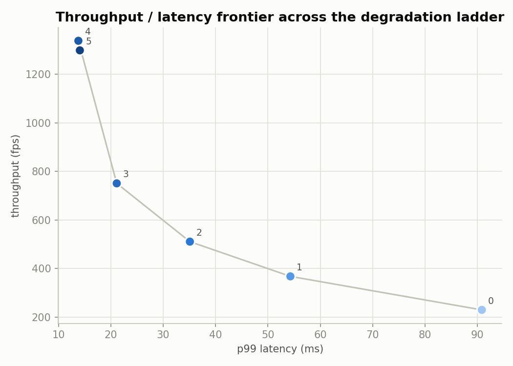

# StreamGuard

Real-time multi-stream GPU object detection with a hard end-to-end latency
deadline (33ms @ 30fps), enforced by an adaptive degradation controller
rather than by dropping frames uncontrolled. Detection (YOLOX) is commodity;
the SLA controller — degrading quality along a fixed ladder under load, with
hysteresis so it doesn't oscillate — is the point of the project.

Target hardware: developed on macOS, run on Google Colab (T4). Code is kept
Jetson-clean (no x86-only assumptions, no hardcoded TensorRT plugin paths, no
baked-in CUDA arch flags) for a possible later port to Jetson Orin Nano.

## Status

All 6 build-order stages complete. The pipeline, SLA controller, experiment
automation, and chart rendering are fully tested against the mock backend
on CPU — 120 tests, no GPU required. What's *not* verified: anything that
touches real CUDA/TensorRT/NVDEC/Docker, since there's no GPU or Docker on
this dev machine. See [GPU-only code](#gpu-only-code-unverified-until-colab)
for the validation checklist to run before trusting any real number out of
this, and [Results](#results) — still placeholders until that happens.

## Architecture

```
Source -> NVDEC decode -> GPU preprocess -> batch -> TensorRT -> postprocess -> out
                                                        ^
                                          SLA Controller (reads p99 latency)
```

- Bounded queues between every stage. Pre-inference queues (decode→preprocess,
  preprocess→batch) drop the oldest frame under backpressure — a stale frame
  only burns deadline budget, so skipping ahead to a fresher one is strictly
  better. The post-inference queue blocks instead: by then real (simulated)
  GPU time has already been spent, so throwing away a completed result is
  pure waste.
- Decode on GPU via NVDEC, with a CPU decode path kept solely to measure the gap.
- Preprocess on GPU; frames stay device-resident from decode through output.
- Dynamic batching aggregates frames across streams: batch on size N *or* a
  timeout since the first frame of the batch arrived, whichever fires first.
- Concurrency model: threads + CUDA streams, one thread per pipeline stage —
  **except decode**, which gets one thread *per stream* (each source is an
  independent blocking I/O resource). Preprocess, batch+infer, and
  postprocess stay single shared threads, which is exactly what makes
  cross-stream batching possible: one inference thread pulling from one
  queue fed by every stream. Not process-per-stream (separate CUDA contexts
  would kill cross-stream batching) and not asyncio (CUDA work isn't
  awaitable, and GIL release during NVDEC/cudaMemcpyAsync/TRT execute
  already gives the concurrency asyncio would otherwise buy).

## What exists today (stage 1)

- **`streamguard/config.py`** — pydantic config schema (stream count, model
  tier/precision, SLA thresholds, degradation ladder, device) loaded from
  YAML (`configs/default.yaml`). Validates hysteresis sanity
  (`recover_threshold_ms < degrade_threshold_ms`) and ladder ordering at load
  time.

  **Why pydantic over plain dataclasses:** the same validate-at-the-boundary
  model as a FastAPI request body, applied to experiment config — a bad
  threshold fails immediately with a clear message instead of surfacing as
  mysterious controller oscillation three stages later.

- **`streamguard/metrics/latency.py`** — `LatencyTracker`: bounded rolling
  window over per-frame, per-stage latency (decode/preprocess/inference/
  postprocess/total), reporting median/p95/p99/variance. Discards a
  configurable number of warmup samples before anything enters the window.

  **Why it doesn't do any timing itself:** the project's measurement rule is
  CUDA events for GPU stage timing, never `time.time()` — host timing only
  captures kernel *submission*, not completion, since GPU work is
  asynchronous. `LatencyTracker` only aggregates ms values it's given, so
  it's agnostic to how they were measured. The actual CUDA-event
  instrumentation is added in stage 3+, at the call sites that do real GPU
  work.

- **`streamguard/metrics/events.py`** — `TransitionLog` / `TierTransition`:
  the record type for degradation-ladder transitions. Just the log, not the
  decision logic — the controller that decides *when* to transition is
  stage 5.

- **`streamguard/metrics/device.py`** — `capture_device_info()`: best-effort
  snapshot of device / driver version / TensorRT version via `pynvml` /
  `tensorrt`, falling back to `None` when those aren't available (e.g. on
  this Mac dev machine, honestly, rather than faking a value).

- **`streamguard/inference/`** — `InferenceBackend` ABC (`load`, `infer`) and
  `MockInferenceBackend`, which simulates a configurable per-(tier,
  precision) latency and returns randomly-shaped detections. Lets the
  queue/batching engine and the SLA controller be built and unit-tested on
  CPU, with no GPU, before any TensorRT integration exists.

## What exists today (stage 2 additions)

- **`streamguard/decode/`** — `Decoder` ABC + `CPUDecoder` (OpenCV
  `VideoCapture`). Real decode, testable locally. `NVDECDecoder` is
  deliberately not written yet — there's no NVIDIA driver on this dev
  machine to verify a binding against, and unlike TensorRT (unavoidable,
  landing stage 4 regardless), GPU-vs-CPU decode is an *experiment* to run
  later, not a stage-2 requirement. It arrives once we're actually on Colab
  and can pick a library against real hardware instead of guessing blind.

- **`streamguard/preprocess/`** — `Preprocessor` ABC + `CPUPreprocessor`:
  standard YOLOX-style letterbox resize (aspect-preserving, gray-114 pad —
  a training-convention value, not arbitrary). Returns `PreprocessMeta`
  (scale + pad) alongside the resized frame so postprocessing can map boxes
  back to the original frame's coordinates. Output stays `(H, W, C)` to
  match `InferenceBackend.infer`'s documented batch shape — no premature
  NCHW/normalization conversion; that's a specific TensorRT engine's input
  contract, decided in stage 4, not a general preprocessing concern.

- **`streamguard/postprocess.py`** — `Postprocessor`: confidence
  thresholding, vectorized greedy NMS, then inverts the letterbox transform
  back to original-frame coordinates. This is real, tested logic (not
  mocked) — it doesn't care whether the boxes it receives came from the
  mock backend or a real TensorRT engine.

- **`streamguard/metrics/timer.py`** — `Timer` ABC + `WallClockTimer`
  (`time.perf_counter`, used via a `with` block around each stage).
  Legitimate for CPU-only stages: the CUDA-events-not-`time.time()` rule
  exists specifically because host timing only captures async GPU kernel
  *submission*, not completion — there's no async GPU kernel here yet to be
  fooled by. A `CudaEventTimer` implementing the same context-manager
  contract lands once a stage actually submits GPU work (stage 4
  inference, or NVDEC/CuPy once running on Colab); the pipeline code that
  does `with timer:` won't need to change, only which `Timer` it's given.

- **`streamguard/pipeline.py`** — `SingleStreamPipeline`: wires decode →
  preprocess → infer → postprocess into one sequential loop for a single
  stream, feeding every frame's per-stage timing into stage 1's
  `LatencyTracker`. No queues, no threads, no batching across streams, no
  SLA controller yet — those are stages 3 and 5. This stage exists purely
  to get the interfaces and instrumentation right on the simplest possible
  case before concurrency is layered on top.

## What exists today (stage 3 additions)

- **`streamguard/bounded_queue.py`** — `BoundedQueue`: thread-safe, with an
  explicit per-instance backpressure policy. `BLOCK` behaves like stdlib
  `queue.Queue`; `DROP_OLDEST` evicts the oldest item to make room instead
  of blocking the producer, and counts every eviction (`dropped_count`) —
  the stdlib queue has no such mode, so this wraps a `deque` with our own
  locking to add one. `get(timeout=...)` raises `queue.Empty` on timeout,
  and returns `None` — a distinct, permanent sentinel — only once the queue
  has been closed *and* drained.

- **`streamguard/config.py`** additions — `QueueConfig` (per-hop size +
  `BackpressurePolicy`) and `BatchConfig` (`max_batch_size`,
  `batch_timeout_ms`). Defaults match the policy above: drop-oldest pre-
  inference, block post-inference.

- **`streamguard/multi_stream_pipeline.py`** — `MultiStreamPipeline` and its
  four worker types (`DecodeWorker` ×N, `PreprocessWorker`,
  `BatchInferenceWorker`, `PostprocessWorker`), connected by `BoundedQueue`s.
  `BatchInferenceWorker` collects frames from any stream until
  `max_batch_size` is reached or `batch_timeout_ms` has elapsed since the
  first frame of the current batch, whichever fires first, then runs one
  `inference_backend.infer()` call per batch.

  **A subtlety worth flagging:** every frame in a dispatched batch is
  charged the *full* batch inference latency, not `latency / N` — all
  frames in a synchronous batch complete at the same instant, so that's
  genuinely each one's wait. Measured with 4 concurrent synthetic streams
  and a fixed ~25ms mock inference cost per call: `max_batch_size=1` gave
  34 fps at p99 total latency 33.1ms (right at the deadline); `max_batch_size=8`
  gave 238 fps — a ~7x throughput gain — but p99 rose to 38.1ms, over the
  33ms deadline. Bigger batches move more frames through the GPU per
  second, at the cost of every one of those frames waiting longer. This is
  exactly the tension the stage-5 SLA controller has to manage.

  Each worker thread captures its own exceptions instead of dying silently
  (`_SafeThread`), and `MultiStreamPipeline.run()` checks for both hung
  threads (via a join timeout) and captured errors after shutdown — with N
  decode threads, a shared batching stage, and bounded queues in between,
  a bug that silently wedges one thread would otherwise surface as a
  mysterious test hang instead of a clear failure.

## What exists today (stage 4 additions)

- **`streamguard/inference/yolox_decode.py`** — `decode_yolox_output()`:
  turns YOLOX's raw anchor-free network output (grid-cell predictions
  across feature-map strides 8/16/32) into the same `Detection` objects the
  mock backend already returns, so `postprocess.py`'s NMS and coordinate
  inversion don't change at all regardless of which backend produced them.
  Pure NumPy math on tensor shapes — **this is the one piece of stage 4
  actually verified here**, including an exact-coordinate test (a
  hand-encoded anchor decodes to precisely the expected box).

- **`streamguard/metrics/cuda_timer.py`** — `CudaEventTimer`, implementing
  the same `Timer` contract as `WallClockTimer` (stage 2) but using real
  CUDA events instead of a host clock — this is the actual mechanism
  CLAUDE.md's measurement rule requires for GPU stages. **Unverified**: no
  CuPy, no CUDA device here.

- **`streamguard/inference/tensorrt_backend.py`** — `TensorRTInferenceBackend`,
  implementing the same `InferenceBackend` interface the mock backend does
  (loads a serialized engine, one execution context per instance, pinned
  host buffers for the H2D copy, calls the decode function above). Uses
  CuPy — not `pycuda` — for all device memory, since CuPy's already the
  intended tool for GPU preprocessing. **Unverified**: written against the
  documented TensorRT 8.5+ `execute_async_v3`/tensor-address API, but there
  is no NVIDIA driver, CUDA, or TensorRT on this dev machine to actually
  run it against.

- **`scripts/build_engine.py`** — ONNX → `.engine`, precision selectable
  (fp32/fp16/int8), with an `IInt8EntropyCalibrator2` for the INT8 path
  that reads a folder of representative frames (path supplied externally;
  never committed, per `.gitignore`). Deliberately does **not** handle
  YOLOX-checkpoint → ONNX export — that needs YOLOX's own
  `tools/export_onnx.py` and its model-definition code, and pulling that
  dependency into this repo just to re-derive ONNX export was the wrong
  trade. This script starts from an already-exported `.onnx` file.
  **Unverified**, same reason as above.

- `test_gpu_backends_fail_clearly.py` (later grown to 9 tests, covering
  `nvdec.py` and `gpu.py` too — see "additional infrastructure" below)
  locks in a narrower, honestly-testable promise for every GPU-only
  module: importing them must not require CuPy/TensorRT (their imports are
  deferred into method bodies, not module level), and calling into them
  without their prerequisites must fail with a specific, clear error — not
  silently produce garbage or die three layers down with an obscure
  traceback.

### GPU-only code: unverified until Colab

Everything above marked unverified needs to be checked against real
hardware before it's trusted, in this order:

1. `python -c "import tensorrt, cupy; print(tensorrt.__version__, cupy.__version__)"`
   — confirm the libraries this code assumes are actually what's installed.
   Separately check whichever NVDEC package actually installs (`PyNvCodec`
   from VPF, or NVIDIA's newer `PyNvVideoCodec`) — `nvdec.py` is the file
   most likely to need edits to match whatever's really there.
2. `capture_device_info()` (stage 1) should return a real driver version and
   TensorRT version, not `None` — if it's still `None` on Colab, something's
   wrong with the environment, not the code. Do the same sanity check for
   `NVMLSampler`: `start()`/`stop()` around a few seconds of idle time should
   leave `unavailable_reason` as `None` and `samples` non-empty.
3. Export one YOLOX checkpoint to ONNX (YOLOX's own tooling), then build the
   cheapest engine first: `scripts/build_engine.py --tier nano --precision
   int8 --input-size 416 --calib-dir <folder>`. Confirm it produces a
   `.engine` file without error.
4. Load that engine with `TensorRTInferenceBackend` and call `infer()` on one
   real preprocessed frame. Confirm no exceptions and sane detection
   count/box coordinates.
5. Swap `TensorRTInferenceBackend` in for `MockInferenceBackend` in
   `SingleStreamPipeline` against one short real video before touching
   `MultiStreamPipeline` — isolate TensorRT problems from concurrency
   problems.
6. Only then swap `CudaEventTimer` in for `WallClockTimer` around the
   inference stage, and confirm the CUDA-event-measured latency is stable
   across repeated runs.
7. Swap in `NVDECDecoder` and `GPUPreprocessor` the same isolated way — one
   real video, `SingleStreamPipeline`, before touching the multi-stream
   path. For `GPUPreprocessor` specifically, diff its output against
   `CPUPreprocessor` on the same frame first; they should match closely.
8. Once real predictions exist, point `evaluate_detections()` at a small
   labeled sample set and sanity-check the mAP number is in a plausible
   range for the tier being tested (roughly: should degrade going down the
   ladder, not improve).

The full precision/stream-count sweep is stage 6 — this checklist is just
"does the new code work at all," not the experiment automation itself.

## What exists today (stage 5 additions)

- **`streamguard/sla_controller.py`** — `SLAController`: reads
  `LatencyTracker.p99()` and steps the degradation ladder one rung at a
  time when it crosses `degrade_threshold_ms`/`recover_threshold_ms`,
  gated by `min_dwell_time_s`. Fully testable against the mock backend —
  no GPU needed, same as everything through stage 3.

  **Why one rung at a time, even under severe overload:** the controller
  re-evaluates on the next sample after its dwell time elapses and steps
  again if still needed. This finds the *minimum* sufficient degradation
  rather than jumping straight to the cheapest tier on the first bad
  sample — otherwise "cheapest sacrifice first" wouldn't mean anything.

  **The interesting wiring problem this created:** the controller decides
  *when* to change tier, but only `BatchInferenceWorker`'s thread is
  allowed to call `inference_backend.load()` (one execution context per
  worker thread — the same rule from the measurement requirements). So
  `SLAController` only exposes thread-safe state (`current_level`,
  `current_tier_config`); `PreprocessWorker` now reads the target
  `input_size` fresh *per frame* via a callable instead of a value fixed
  at construction (a tier change can shrink 640→416 mid-run), and
  `BatchInferenceWorker` checks the controller's level before each batch
  and calls `load()` itself if it's moved, tagging every frame in that
  batch with the tier that was actually active for it. `PostprocessWorker`
  just uses that tag and triggers `maybe_transition()` after each fresh
  sample — no cross-thread writes to the inference backend from anywhere
  but the one thread that owns it.

  `SingleStreamPipeline` (stage 2) got the same optional `sla_controller`
  parameter for consistency, trivially simpler there since it's one
  thread — no "which thread is allowed to call load()" question at all.

  Verified with a cross-thread integration test: a backend configured with
  a deliberately-slow baseline tier and a fast fallback tier, run through
  the full multi-threaded pipeline, confirms the model actually gets
  reloaded (checked against the backend's own recorded config, not just
  the latency tags) and every frame ends up tagged with the tier that was
  really active when it ran.

## What exists today (stage 6 additions)

- **`streamguard/experiments/`** — the sweep logic, as importable/testable
  library functions (thin CLI wrappers live under `scripts/`):
  - `stream_count_sweep.py`: ramps concurrent stream count at a fixed
    degradation tier until p99 violates the deadline, stopping one trial
    past the first violation and reporting the max sustainable N.
  - `precision_sweep.py`: one trial per ladder rung — latency, throughput,
    and (when an `NVMLSampler` is supplied and available) mean power draw.
  - `map_trial.py`: per-tier mAP, deliberately bypassing
    `MultiStreamPipeline` entirely — evaluating against a fixed labeled set
    is an offline concern, not a live-streaming one, so it doesn't need any
    of the queueing/threading machinery.
  - `decode_comparison.py`: CPU-vs-NVDEC decode throughput and CPU
    utilization (only CPU is runnable here).
  - `sources.py`: resolves real video files (round-robin reused up to the
    requested count) or generates synthetic clips when none are supplied.

  All runnable today against the mock backend to verify the automation
  *logic* — and actually run, not just written: the stream-count sweep
  script found that at low stream counts, `batch_timeout_ms`'s wait (for a
  batch that will never fill, since there's nothing else to batch with)
  adds pure latency for zero benefit — see **What didn't work** below.
  Point `--backend tensorrt --engine-dir <dir>` at a real engine directory
  once stage 4 is verified for numbers that mean something.

- **`streamguard/experiments/render_charts.py`** — matplotlib frontier
  charts (latency vs. stream count, throughput/latency/power per tier, the
  throughput-latency frontier curve itself), following the `dataviz`
  skill's validated default palette: categorical slots 1–3 for the three
  percentile lines, a single-hue **ordinal** ramp for the ladder tiers
  (they're a genuine ordered progression, not arbitrary categories — this
  is the palette's documented ordinal use case, not a generic 6-color
  categorical scheme). `matplotlib` is an optional (`viz`) dependency,
  imported lazily so `streamguard.experiments` stays importable without it
  — checked by actually uninstalling matplotlib and confirming the package
  still imports, with only the plotting functions failing, clearly.
  Rendered and visually inspected against real (mock-backend) sweep
  output, not just "didn't crash."

- **`streamguard/metrics/prometheus_exporter.py`** — `PrometheusExporter`:
  latency percentiles, frames processed, degradation tier, and per-queue
  depth/drop counts as Prometheus gauges. A private `CollectorRegistry` per
  instance avoids colliding with the client library's global default.
  Tested via `generate_latest()` against the registry directly, so no real
  HTTP port is needed for the test suite.

- **`scripts/serve.py`** — the actual long-running service entrypoint (what
  the Docker image's default command runs): wires `MultiStreamPipeline` +
  `SLAController` + `PrometheusExporter` together, with a background
  thread pushing tracker/controller state into the exporter on an
  interval. Actually run end-to-end against the mock backend — multiple
  loops completed cleanly with no exceptions. Couldn't confirm the metrics
  HTTP endpoint is reachable via `curl` from this specific sandboxed shell;
  verified that's a sandbox network restriction (an unrelated plain stdlib
  HTTP server is equally unreachable the same way here), not a bug in the
  exporter or the service.

- **`Dockerfile`, `docker-compose.yml`, `docker/`** — the CUDA-based image,
  a compose file wiring `streamguard` + `prometheus` + `grafana` together
  (GPU reservation via the modern Compose `deploy.resources.reservations`
  syntax), Prometheus's scrape config, and Grafana's datasource/dashboard
  provisioning plus the dashboard JSON itself (latency histogram,
  degradation tier, queue depth, dropped frames — the panels CLAUDE.md
  asks for). **Unverified** — no Docker on this dev machine to build or run
  against — but JSON/YAML syntax is validated, and a test cross-checks
  every dashboard panel's PromQL expression against the exporter's actual
  metric names, so a renamed gauge would fail a test rather than silently
  break a panel.

- **`notebooks/streamguard_colab.ipynb`** — the Colab runbook: clone →
  install → confirm GPU/driver/TensorRT versions → (external step: export
  YOLOX to ONNX) → build one engine per ladder rung → the single-frame and
  single-stream validation steps from the checklist below, in order →
  run the sweeps for real → render the charts. Structurally validated
  (valid nbformat JSON, every code cell's Python syntax-checked), but never
  executed — no Jupyter/Colab runtime here. Now points at the real repo
  ([shruthib18122001-commits/StreamGuard](https://github.com/shruthib18122001-commits/StreamGuard))
  instead of a placeholder.

## What exists today (additional infrastructure)

These don't map to a single numbered build-order stage — they were
deferred throughout stages 2–4 as genuinely GPU-only or data-only work with
no local way to verify them, and are filled in now:

- **`streamguard/metrics/nvml_sampler.py`** — `NVMLSampler`: background
  thread sampling power, SM/memory clocks, temperature, throttle reasons,
  and memory usage at a fixed interval — the continuous telemetry that
  distinguishes "code got slower" from "GPU throttled" (stage 1's
  `capture_device_info()` is a one-time snapshot, not this). Same
  graceful-degradation contract as everything else GPU-only: `start()` is
  a documented no-op with a recorded `unavailable_reason` when there's no
  driver, never a crash.

- **`streamguard/evaluation/map_eval.py`** — `evaluate_detections()`:
  standard object-detection mAP (all-point interpolated AP, optionally
  averaged over COCO's 10 IoU thresholds for mAP@[.5:.95]). Pure NumPy —
  **fully verified here** against hand-computable toy cases, including a
  duplicate-detection case that confirms a documented, easy-to-get-wrong
  property of this metric: a low-confidence duplicate of an
  already-matched box counts as a false positive but doesn't reduce AP if
  a higher-confidence detection already reached full recall. This is the
  harness only — it needs real predictions and labeled ground truth to
  produce a number that means anything, and there's no labeled data in
  this repo yet.

- **`streamguard/decode/nvdec.py`** — `NVDECDecoder`, real hardware decode
  via VideoProcessingFramework's `PyNvCodec` bindings, behind the same
  `Decoder` interface as `CPUDecoder` — this is what the NVDEC-vs-CPU
  decode experiment needs a real baseline to run against.
  **Least-verified file in this repo**: NVIDIA's NVDEC Python bindings
  have shifted across versions more than TensorRT's API has, so treat the
  exact method names here as the first thing to re-check on Colab, ahead
  of `tensorrt_backend.py` or `cuda_timer.py` — those APIs are considerably
  more stable.

- **`streamguard/preprocess/gpu.py`** — `GPUPreprocessor`: the same
  letterbox math as `CPUPreprocessor`, executed as CuPy device-array ops
  so a frame can stay device-resident from decode through inference.
  Unverified; worth checking for exact output parity against
  `CPUPreprocessor` on the same real frame once there's a GPU to run it on.

## Degradation ladder

| Level | Model      | Precision | Size | Frame skip |
|-------|------------|-----------|------|------------|
| 0     | YOLOX-m    | FP16      | 640  | 1          |
| 1     | YOLOX-s    | FP16      | 640  | 1          |
| 2     | YOLOX-s    | INT8      | 640  | 1          |
| 3     | YOLOX-tiny | INT8      | 416  | 1          |
| 4     | YOLOX-nano | INT8      | 416  | 1          |
| 5     | YOLOX-nano | INT8      | 416  | 2          |

## Build order

1. ✅ Skeleton, config system, metrics collection, mock inference backend
2. ✅ Single-stream end-to-end with real latency instrumentation
3. ✅ Multi-stream: bounded queues, dynamic batching
4. ✅ TensorRT integration, precision variants, engine build scripts (unverified — see checklist above)
5. ✅ SLA controller: degradation ladder + hysteresis
6. ✅ Experiment automation, charts, Docker, Grafana, README completion

## Results

_Placeholder — populated once real streams run on Colab T4 hardware, via
the [Colab notebook](notebooks/streamguard_colab.ipynb) and the checklist
above:_

- Max sustainable stream count per degradation tier: **TBD**
- NVDEC vs CPU decode throughput / CPU utilization: **TBD**
- FP32 / FP16 / INT8 latency, throughput, power, mAP sweep: **TBD**
- Degradation tier transition timeline under load: **TBD**

The sweep *automation itself* is verified end-to-end against the mock
backend (`streamguard/experiments/`, 16 tests) — running it produces real
CSVs and real charts, like the frontier plot below (mock-backend numbers,
not real hardware — placeholders above still apply). What's missing is
stage 4's GPU code actually running, which is what turns these from
"the harness works" into "here's what StreamGuard actually does":



## What didn't work

_Kept because it's often the most credible part of a systems project —_
_these were all found by actually running the code, not by inspection:_

- **`total_ms` silently ignored queueing delay.** Through stage 4,
  `MultiStreamPipeline`'s per-frame `total_ms` was the sum of each stage's
  own active duration (decode + preprocess + inference + postprocess). Under
  real concurrent load a frame can sit in a bounded queue waiting its turn
  — e.g. backed up behind other frames at the batcher — and that wait was
  invisible to every one of those four numbers. Both the SLA controller
  (reads `total_ms`'s p99 to decide when to degrade) and the stream-count
  sweep (needs `total_ms` to actually rise under overload) would have
  silently missed real backpressure. Fixed by threading a frame-start
  timestamp through the pipeline and computing `total_ms` as true
  wall-clock elapsed time since decode began, not a sum of durations —
  caught by a regression test before it reached anything downstream.

- **Dynamic batching's fixed timeout hurts low-concurrency latency, for no
  throughput benefit.** Running the stream-count sweep at N=1 against the
  mock backend's baseline tier showed p99 latency around **90ms** — nearly
  3x the 33ms deadline — even though a single frame's actual decode/
  preprocess/inference/postprocess cost is a fraction of that.
  `BatchInferenceWorker` was waiting the full `batch_timeout_ms` (10ms
  default) on every batch, hoping more frames would arrive to fill it —
  frames that, with only one stream, were never coming. The timeout is
  pure latency tax with zero throughput upside until there's enough
  concurrent volume to actually benefit from it. Worth tuning
  `batch_timeout_ms` down (or the SLA controller accounting for current
  stream count) specifically in the low-N regime rather than using one
  fixed value across the whole stream-count range.

- **Truthiness bug in `MockInferenceBackend`'s constructor** (stage 1):
  `latency_table = latency_table or DEFAULT_TIER_LATENCY_MS` silently
  ignored an explicitly-passed *empty* dict, since `{}` is falsy in Python
  — a test passing `latency_table={}` to check an unconfigured-tier error
  got the default table instead and didn't fail the way it should have.
  Fixed to an explicit `is None` check. A reminder that `x or default` is
  the wrong idiom whenever an empty-but-valid value is meaningfully
  different from "not provided."

- **`SLAController`'s dwell-time gate blocked the very first transition**
  (stage 5): initializing `_last_transition_time = time.time()` at
  construction meant a test passing a synthetic `now` far from real
  wall-clock time computed a huge (and wrongly negative-feeling) elapsed
  gap, blocking any transition until an absurdly distant "dwell time" had
  passed. Fixed by initializing to `0.0` instead — there's been no
  transition yet, so the first check should never be gated by one.

## Running tests

```bash
pip install -e ".[dev,viz]"   # viz pulls in matplotlib, for the chart-rendering tests
pytest -v
```

No GPU required — 120 tests, all passing on a plain Mac. The pipeline, SLA
controller, and experiment automation are fully tested against the mock
inference backend; the GPU-only modules (`tensorrt_backend.py`,
`cuda_timer.py`, `nvdec.py`, `gpu.py`, `scripts/build_engine.py`) are only
tested for graceful, clear failure in the absence of CUDA/TensorRT/CuPy —
see [GPU-only code](#gpu-only-code-unverified-until-colab) above for what
actually validates them.

## Watching the SLA controller actually degrade (mock backend, no GPU)

```bash
python scripts/demo_sla_degradation.py
```

The clearest "does the core mechanism work" check outside the test suite:
4 concurrent streams overload a deliberately-slow baseline tier, the
controller drops rungs in response to real p99 values, and the printed
transition log plus the backend's own recorded config confirm the model
actually got reloaded — not just a latency tag changing.

## Running the live service locally (mock backend, no GPU)

```bash
python scripts/serve.py --config configs/default.yaml --metrics-port 9108 --max-loops 3
curl localhost:9108/metrics   # once it's up
```

Loops synthetic clips through the full pipeline with the SLA controller
active, exposing Prometheus metrics the whole time. `docker-compose up`
wires this together with real Prometheus + Grafana — unverified, since
there's no Docker on this dev machine (see stage 6 above).
